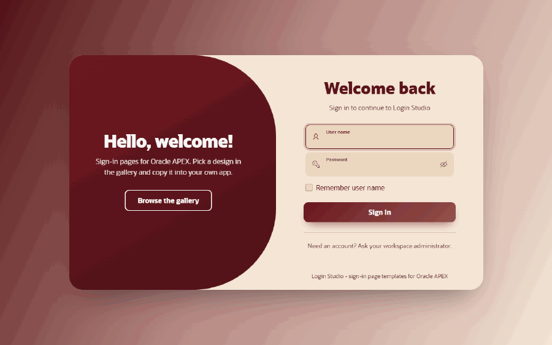
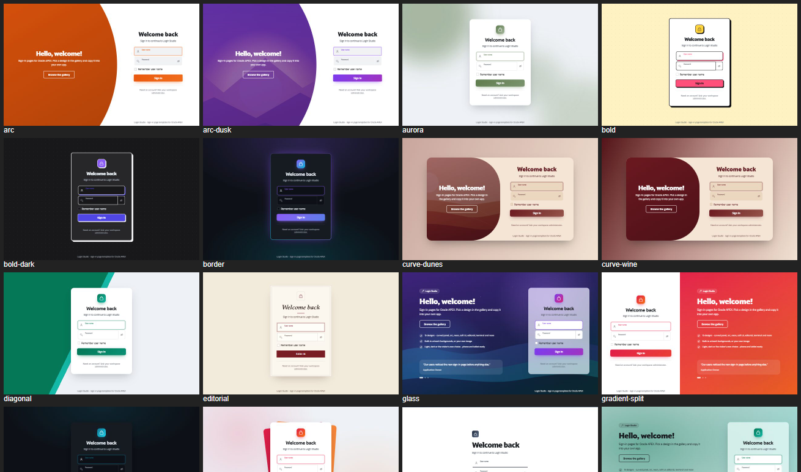
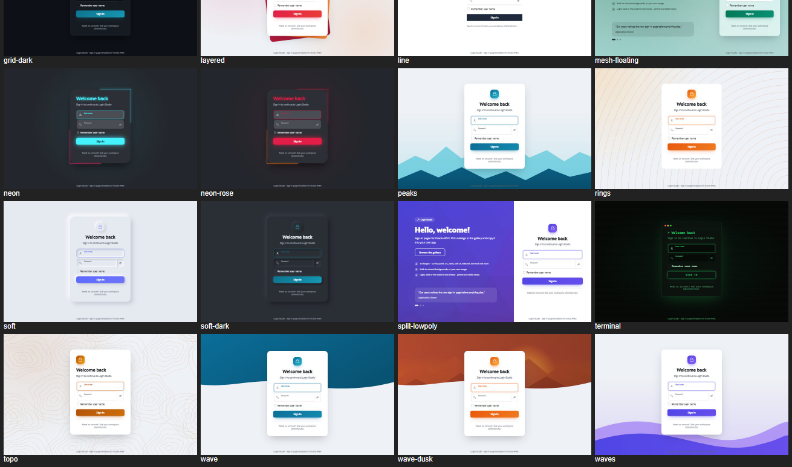
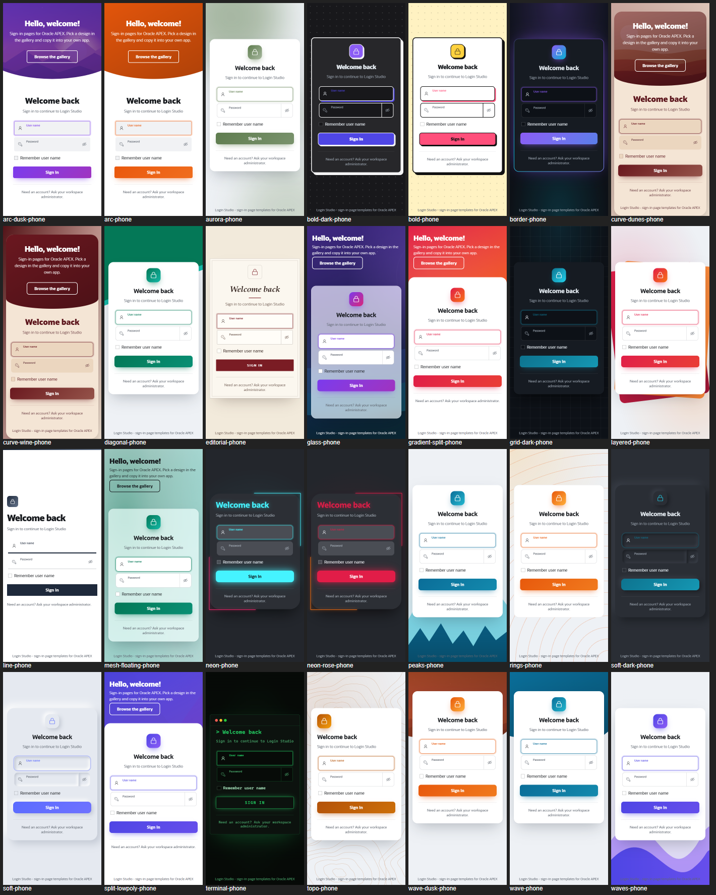
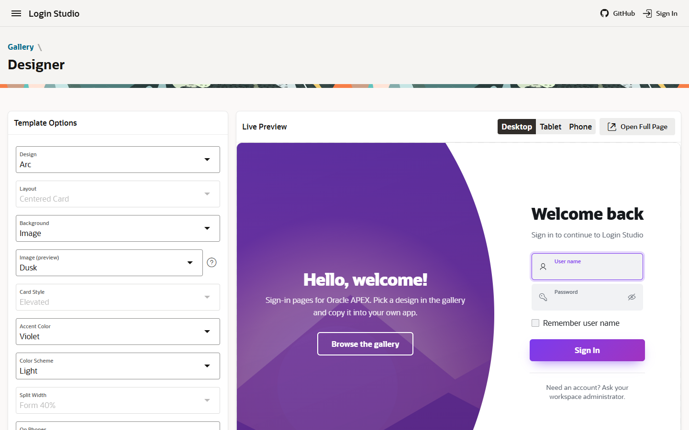

# Login Studio for Oracle APEX

[](https://apex.oracle.com) [](LICENSE)

Beautiful sign-in pages for Oracle APEX - **one page template, 13 designs, built-in artwork backgrounds, your own images, light and dark**. Every look is a template option: nothing to code on the page.



Login Studio is a small APEX application: a **Gallery** of ready-made looks, a **Designer** that previews every option live on phone, tablet and desktop, and the **Modern Login** page template itself, which you copy into your own application.

## Designs

| Design | Look |
|---|---|
| Classic | A card over an animated aurora; follows the Layout, Card Style and Background options |
| Curved Panel | One card - a coloured panel with a big curve next to the form |
| Arc | A big coloured circle sweeps in from the side, the form sits on white |
| Neon | A dark card with glowing corner lines and a glowing button |
| Soft UI | Neumorphic - the card is raised, the fields are pressed in (light or dark) |
| Minimal Line | No card, a large title and underlined fields |
| Diagonal | A two-tone page split on the diagonal |
| Wave | A coloured band with a wave edge across the top |
| Bold | Neo-brutalist - thick ink outlines and hard offset shadows |
| Gradient Border | A colour ring turning around the card |
| Layered Cards | Two coloured cards fanned out behind the form |
| Editorial | Paper colours, a serif headline and fine rules |
| Terminal | A console window with a blinking cursor |

Every design can be recoloured (10 accent colours, or your theme colour), switched to dark, and combined with:

- **Backgrounds** - aurora, mesh, bold gradient, dot grid, solid, and built-in artwork drawn in the accent colours (**Waves, Topography, Peaks, Rings, Grid Lines**) - no image file needed;
- **Your own image** - put it in the *Background Image* slot; Curved Panel, Arc and Wave show it inside their panel;
- **Layouts** - centred card, split left / right, floating panel left / right, with a brand panel for your welcome text;
- **Card styles** - elevated, frosted glass, outlined, borderless; corners, widths, header alignment;
- **Behaviour** - entrance animation, busy button on submit, shake on error, Caps Lock hint, offline banner, a light / dark toggle the visitor controls, auto-rotating slides.

Built for phones first: the brand panel becomes a banner, inputs never zoom, short and landscape phones keep the Sign In button above the fold, and *Edge to Edge* turns the card into a full-screen sheet.




<details><summary>Every look on a phone</summary>


</details>

## Install

1. Download [`login-studio.sql`](login-studio.sql).
2. In your workspace: **App Builder > Import**, choose the file and install it with any application ID. There are no database objects. Requires **APEX 26.1** or later.
3. Run it: the Gallery, Designer and How to Use pages are public.

The APEXlang source of the application is in [`apexlang/`](apexlang/) (`apex import -input apexlang` with SQLcl 26.1).

## Use it in your application

1. **Copy the template.** In *your* application open **Shared Components > Templates > Create**, choose **Page**, **As a Copy of an Existing Template**, copy from **Login Studio** and pick **Modern Login**. Tick *Subscribe* if you want later updates.
2. **Use it on the login page.** Set **Appearance > Page Template** to **Modern Login** and pick the **Template Options** you built in the Designer (Design, Background, Accent Color, Color Scheme ...). Keep the login region on the standard *Login* region template.
3. **Optional content** in the template's slots (region template *Blank with Attributes*):

| Slot | Use it for |
|---|---|
| Brand Panel | Welcome text next to the form (Curved Panel, Arc, Split / Floating layouts); a banner on phones |
| Top Bar | A logo and links above the form |
| Body Header / Body Footer | Notes inside the card |
| Page Footer | Copyright and links under the card |
| Background Image | `` for Background = Image |

A brand panel like the demo's:

```html
<h1>Hello, welcome!</h1>
<p>Sign in to manage your requests and approvals.</p>
<a class="ml-Cta" href="f?p=&APP_ID.:REGISTER:&APP_SESSION.">Create an account</a>
```

Helper classes: `ml-Cta` (call-to-action link), `ml-Lead` (sub-title), `ml-Logo`, `ml-Badge`, `ml-Slides` (each child is a slide). Built-in texts can be translated with the text messages `MODERN_LOGIN.CAPS_LOCK`, `MODERN_LOGIN.OFFLINE` and `MODERN_LOGIN.THEME`.

The template is self-contained - its CSS, JavaScript and artwork travel with it, and the login page needs no JavaScript or CSS of its own.



## Notes

- A page template field holds at most 32 KB, so the template's CSS continues in `<style>` blocks of its header and body - keep them when you edit the template.
- Reduced-motion users get no animations; Windows high-contrast mode is respected.
- The demo backgrounds (`bg-*.svg`, `login-bg.svg`) are original artwork and free to use.

## Support

Questions, bugs and ideas: [GitHub Issues](https://github.com/HashaamShoukat/apex-login-studio/issues).

[MIT](LICENSE) © 2026 Hashaam Shoukat
